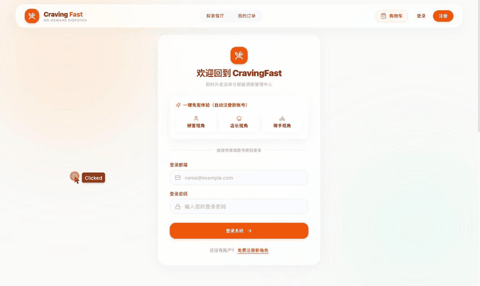
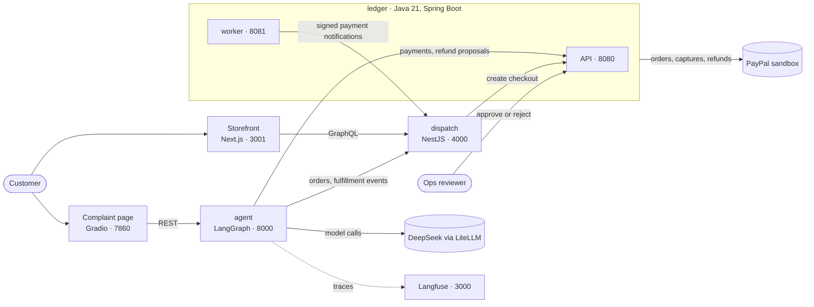

# FairSettle

An AI agent decides how much to refund a food-delivery customer and who pays for it — the restaurant, the driver or the platform — and a double-entry ledger moves the money on PayPal.

Built for the PayPal AI Hackathon (2026); sandbox only.

## Demo



A customer pays with PayPal, complains about a missing item, the agent proposes a refund charged to the restaurant, a reviewer approves, and the refund lands in PayPal and the ledger.

Video: coming with F31.

## How it works

1. A customer orders in the storefront and pays through PayPal checkout created by the ledger; dispatch tracks the order and the courier.
2. The customer files a complaint on the complaint page, or dispatch reports a failed delivery and the agent opens a case by itself.
3. The agent gathers the order, its fulfillment events and the ledger's payment. It may call up to three read-only tools: fulfillment events, the ledger payment and the customer's history.
4. The model proposes an outcome: refund type, amount in cents, and the liable party. A deterministic policy then checks it (amount caps, repeat complaints, unconfirmed payments) and can escalate.
5. A human reviewer approves or rejects the exact proposal on the ledger's review page; the agent never moves money.
6. On approval the ledger refunds through PayPal, then posts a journal that charges the liable party; the complaint page updates by itself.

- Money is integer cents; liability splits are basis points summing to 10000.
- Only the ledger holds PayPal credentials and calls PayPal.

## Architecture



| Service | Stack | Port | Role |
| --- | --- | --- | --- |
| ledger API | Java 21, Spring Boot | 8080 | Payments, refunds and review |
| ledger worker | Java 21, Spring Boot | 8081 | Recovery and notifications |
| dispatch | NestJS, TypeORM | 4000 | Orders and courier fulfillment |
| storefront | Next.js | 3001 | Ordering and checkout |
| agent | Python, LangGraph, LiteLLM | 8000 | Refund and liability decisions |
| complaint page | Python, Gradio | 7860 | Complaint intake and status |
| Langfuse | Langfuse | 3000 | Agent traces |

The ledger, dispatch and agent each have their own PostgreSQL (the agent's runs in the full chain only); the ledger also uses Redis and Kafka, and dispatch uses Redis. See [PayPal state mapping](docs/adr/paypal-state-mapping.md) for how PayPal states map onto the ledger.

## Quick start

### 1. Core stack (no credentials)

You need Git, Docker with Compose v2 and at least 4 GB of memory for Docker, and ports 8080, 8081 and 4000 free. The clone URL will be filled in when the repository goes public.

```bash
git clone https://github.com/<owner>/FairSettle.git
```

```bash
cd FairSettle
```

```bash
docker compose up -d --wait
```

The first run builds the ledger and dispatch images and takes several minutes. This starts PostgreSQL, Redis and Kafka plus the ledger API, ledger worker and dispatch, with local development passwords only.

Check the ledger API:

```bash
curl -fsS http://localhost:8080/actuator/health
```

Expected output:

```json
{"status":"UP"}
```

Check the ledger worker:

```bash
curl -fsS http://localhost:8081/actuator/health
```

Expected output:

```json
{"status":"UP"}
```

Check dispatch:

```bash
curl -fsS 'http://localhost:4000/graphql?query=%7B__typename%7D'
```

Expected output:

```json
{"data":{"__typename":"Query"}}
```

Stop the stack when finished; this keeps the data volumes:

```bash
docker compose down
```

### 2. Run the tests

| Service | Needs | Command |
| --- | --- | --- |
| ledger | JDK 21 and Docker | `cd ledger && ./mvnw verify` |
| dispatch | Node 22 | `cd dispatch && npm ci && npm test` |
| storefront | Node 20 or later | `cd dispatch/frontend && npm ci && npm test` |
| agent | Python 3.11, uv and Docker | `cd agent && uv sync --python 3.11 && .venv/bin/python -m pytest -q` |
| scripts | Python 3.11 or later | `python3 -m unittest discover -s scripts/tests -p 'test_*.py'` |

No test calls PayPal or a real model.

### 3. Full chain (your own credentials)

The full chain adds the agent, complaint page, storefront and Langfuse, and real PayPal sandbox payments and refunds. You need:

- A PayPal sandbox REST app from the PayPal developer dashboard, with its sandbox PERSONAL and BUSINESS accounts.
- A DeepSeek API key.
- ngrok with a stable host.
- Docker with at least 8 GB of memory.

```bash
cp env.live.example .env.live
```

Fill every value as described in the [runbook](docs/m2-live-run.md); never commit `.env.live`.

```bash
docker compose --env-file .env.live -f docker-compose.yml -f docker-compose.live.yml up -d --build --wait
```

Follow [the full procedure](docs/m2-live-run.md) for the tunnel, scripted run, review page, storefront and complaint page. The local pages are:

- Storefront: http://localhost:3001
- Complaint page: http://localhost:7860
- Review page: http://localhost:8080/refund-proposals.html
- Langfuse: http://localhost:3000

## Evaluation

Accuracy: 29/30 (0.97) · Violations: 0/30

Model: `deepseek/deepseek-v4-pro`. Commit: `590c17e`.

Ten scenarios × 3 runs against the real model, from fixtures, through gather, investigate, decide and policy. A violation is an outcome the policy must never allow. The one miss was s05, "Already refunded": it escalated once instead of being rejected.

See [the evaluation results](docs/eval-results.md). To rerun:

```bash
cd agent && .venv/bin/python -m evals.run --runs 3 --assert-zero-violations --min-accuracy 0.9 --out ../docs/eval-results.md
```

This needs the agent's environment from the tests table above and `DEEPSEEK_API_KEY`, and takes about 15 minutes.

## Pre-existing code and hackathon work

The boundary is 2026-10-01 00:00 Beijing time (UTC+8), by commit date.

**Pre-existing:** the 17 ledger commits PR00–PR11, `2ba58da` (2026-09-11) to `d11a3ea` (2026-09-29). They were imported with their history in `13ef4e6`. They contain:

- Specs and contracts; the Java 21 API/worker skeleton; trusted identities.
- Immutable posting and balance rebuild; provider ports and a fault simulator; test-mode Stripe adapters.
- The business payment lifecycle; durable operation recovery; the webhook inbox.
- The notification outbox over Kafka; balance-transaction import; refund reservation recovery.

**Built during the hackathon,** from `8450d17` (2026-10-01) on:

- The ledger's later PRs and every F-feature.
- The dispatch service (started 2026-10-18) and its storefront checkout.
- The agent: complaint intake, investigation tools, decision, policy and review loop, and proactive cases.
- The PayPal adapter and refund proposals.
- Liability posting.
- The evaluation.
- The complaint page.
- The one-command compose stacks.

The feature tracker is [docs/features.json](docs/features.json), and the work log is [docs/progress.md](docs/progress.md). See [docs/challenges.md](docs/challenges.md) for the hardest problems.

Check the boundary yourself:

```bash
git log --before='2026-10-01T00:00:00+08:00' --format='%h %ad %s' --date=short
```

## Repository layout

| Path | What | Stack | Ports |
| --- | --- | --- | --- |
| `ledger/` | Payments ledger: double-entry, payment/refund state machines, PayPal and Stripe adapters, ops console | Java 21, Spring Boot, PostgreSQL, Kafka, Redis | API 8080, worker 8081 |
| `dispatch/` | Order and dispatch API: orders, couriers, fulfillment | NestJS, TypeORM, PostgreSQL, Redis | 4000 |
| `agent/` | Refund and liability agent | Python, LangGraph, LiteLLM, Langfuse | 8000, UI 7860 |
| `contracts/` | Cross-service API contracts and shared fixtures | OpenAPI, JSON | |
| `docs/` | PRD, ADRs, plans, feature list, progress log | | |

Service guides: [ledger/README.md](ledger/README.md), [dispatch/README.md](dispatch/README.md), [agent/AGENTS.md](agent/AGENTS.md).

## Limitations

- Sandbox only; never run it with live PayPal credentials.
- Not deployed; everything runs locally.
- The live overlay keeps PayPal webhooks off. Payments are captured when read, and refunds post from PayPal's synchronous response.
- The agent API and the complaint page have no authentication. They bind to 127.0.0.1 and must not be exposed.
- The storefront's quick demo login is for local demos only.
- See [known issues](docs/known-issues.md).

## License

GNU Affero General Public License v3.0 (AGPL-3.0) — see [LICENSE](LICENSE).

Copyright (C) 2026 MichikatsuOwO.

The AGPL also requires anyone who runs a modified version as a network service to offer its source to that service's users.
