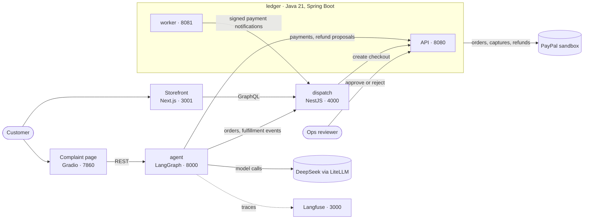

# F30 · README and architecture

## Goal

Behavior (copied from docs/features.json):

> English README: one-line pitch, demo GIF, architecture diagram, quick start, eval results, what was pre-existing vs built during the hackathon.

Verification (copied from docs/features.json, `kind: manual`):

1. Fresh clone on another machine starts with the quick start alone
2. No secrets in the repository (git log -p | grep checks)

The human confirms both steps with `python3 scripts/features.py verify F30`. This plan makes both steps checkable:
- a root `README.md` whose quick start needs no credentials for its first part;
- `scripts/secret_scan.py`, which runs the `git log -p` checks and prints only pattern names, commits and paths, never a value.

### Decisions (user, 2026-11-02)

1. **Two-part quick start.** Part 1 needs no credentials: `docker compose up -d --wait` starts the core stack, three `curl` checks, and how to run each service's tests. Part 2, the full chain, needs your own PayPal sandbox app, a DeepSeek key and ngrok, and points to `docs/m2-live-run.md`. Verification step 1 is judged on part 1.
2. **Demo GIF recorded by the human after the work commit.** The README references `docs/media/demo.gif` from the start. The human records it, converts it with the ffmpeg command in Steps, and commits it as a review fix. `verify` runs only after the GIF is in.
3. **Boundary: 2026-10-01 00:00 Beijing time (UTC+8).** Commits dated before it are pre-existing. Everything from it on was built during the hackathon. The time zone must be part of the boundary, because the commits carry more than one UTC offset.
4. **License: the strictest common open-source license, GNU AGPL-3.0.** The hackathon rules require a public repository with an open-source license shown in GitHub's About panel. The repository has no `LICENSE` yet.

### What was checked (2026-11-02)

- **No root README.** `ledger/README.md` (Chinese) and `dispatch/README.md` (English) exist and stay unchanged.
- **History boundary.** `git log --before='2026-10-01T00:00:00+08:00'` lists 17 commits, all ledger. The count is the same with `TZ=UTC` and `TZ=America/Los_Angeles`. A bare `--before=2026-10-01` is wrong: git fills in the current time of day, which pulls in `8450d17`, `0770f43` and `f0ce128` (2026-10-01 after midnight; found by Codex before the work commit). `--before` compares the committer date, which equals the author date for every commit near the boundary. The 17 commits:
  - first `2ba58da` (2026-09-11, `docs(PR00): …`);
  - last `d11a3ea` (2026-09-29, `feat(PR11): …`).

  The first commit on or after 2026-10-01 is `8450d17` (2026-10-01, ledger `PR12`, revenue sharing). There are 272 commits since. The ledger's history came in through the subtree merge `13ef4e6`. The dispatch service was started 2026-10-18 and imported with `e44ec88` on 2026-10-22. The agent's first commit is `803bcc7` (2026-10-22).
- **Pre-existing ledger commits, PR00–PR11.** Specs and contracts; the Java 21 API/worker skeleton; trusted identities; immutable posting and balance rebuild; provider ports and a fault simulator; test-mode Stripe adapters; the business payment lifecycle; durable operation recovery; the webhook inbox; the notification outbox over Kafka; balance-transaction import; refund reservation recovery.
- **Secret scan of `git log -p --all`** (about 40 MB, read only, values never printed):
  - The only `[AE]…{78,}` matches (PayPal-like tokens) are npm `sha512-` integrity hashes in `package-lock.json` files. There is also one long underscore identifier in a `docs/evidence/pr05` JSON.
  - No `sk-…`, `pk-lf-`/`sk-lf-` + 32 hex, Stripe keys, private keys, AWS or GitHub tokens.
  - Secret-named variables (`PAYPAL_CLIENT_SECRET`, `DEEPSEEK_API_KEY`, the Langfuse keys and so on) only ever hold `${…}` references, empty values, `pk-lf-test…` or `replace-with-…` placeholders.
  - The rules in `scripts/secret_scan.py` below were dry-run against this history: 0 hits.
  - Only `.env.example` and `ledger/.env.example` were ever committed among `.env*` files. `.gitignore` ignores `.env` and `.env.*` except `.env.example`.
- **Core stack without credentials.**
  - The root `docker-compose.yml` interpolates no variables.
  - It builds `ledger/` and `dispatch/` from source in Docker.
  - It publishes 8080, 8081 and 4000.
  - On the running stack:
    - `curl -fsS http://localhost:8080/actuator/health` → `{"status":"UP"}`;
    - the same on 8081;
    - `curl -fsS 'http://localhost:4000/graphql?query=%7B__typename%7D'` → `{"data":{"__typename":"Query"}}`.
- **Service test commands** (from each service's `AGENTS.md`):
  - ledger: `./mvnw verify`, JDK 21 and Docker;
  - dispatch: `npm ci` and `npm test`, Node 22 as in its Dockerfile;
  - storefront: `npm ci` and `npm test` in `dispatch/frontend`;
  - agent: `uv sync --python 3.11`, then `python -m pytest -q`, with Docker running;
  - scripts: `python3 -m unittest discover -s scripts/tests -p 'test_*.py'`, 47 tests today.
- **Evaluation.** `docs/eval-results.md` header: `Model: deepseek/deepseek-v4-pro`, `Commit: 590c17e`, `Accuracy: 29/30 (0.97) · Violations: 0/30`.
- **`env.live.example` and `docs/m2-live-run.md`** tell readers to copy the PayPal sandbox id and secret "from the root .env". That `.env` is this machine's only, not a fresh clone's. No test pins these comments.

## Existing code to follow

- `scripts/tests/test_compose.py`: unittest layout, `ROOT = Path(__file__).resolve().parents[2]`, plain asserts.
- `scripts/tests/test_m2_live_run.py`: loading a script from `scripts/` by path with `importlib.util.spec_from_file_location`.
- `scripts/features.py`: a standalone stdlib script with `main()` and exit codes.
- `docs/m2-live-run.md`: tone and level of detail for operator instructions.

## Changes

### `LICENSE` (new)

The unmodified text of the GNU Affero General Public License version 3, from `https://www.gnu.org/licenses/agpl-3.0.txt`:

```bash
curl -fsSL https://www.gnu.org/licenses/agpl-3.0.txt -o LICENSE
```

Do not edit it. Do not add a copyright line inside it; the README's License section names the holder. If the download fails (no network), stop and ask the human to run the command; do not type the license from memory.

### `scripts/secret_scan.py` (new)

A stdlib-only script that scans the whole history for credentials and never prints a matched value.

```python
"""Scan the whole git history for credentials (F30). Prints pattern names, commits and paths, never values.

Exit 0: no hits. Exit 1: hits. Exit 2: git failed.
"""

ROOT = Path(__file__).resolve().parents[1]

@dataclass(frozen=True)
class Hit:
    pattern: str
    commit: str   # full sha of the commit whose diff has the line
    path: str     # the b/ path of the diff

PATTERNS: dict[str, re.Pattern[str]]   # see the table below
ENV_NAMES: tuple[str, ...]             # see below
PLACEHOLDER = re.compile(r"(?i)^(replace|your|change|example|dummy|test|fake)")
INTEGRITY = re.compile(r"sha(1|256|384|512)-[A-Za-z0-9+/=]+")
ENV_FILE = re.compile(r"^\.env(\..+)?$")   # matched against the basename

def scan_lines(lines: Iterable[str]) -> list[Hit]: ...
def main(argv: list[str] | None = None, run=subprocess.run) -> int: ...

if __name__ == "__main__":
    sys.exit(main())
```

`PATTERNS`. Every pattern except `private_key` begins with the lookbehind `(?<![A-Za-z0-9_-])`, shown as `LB`:

| Name | Regex |
| --- | --- |
| `paypal_like_token` | `LB[AE][A-Za-z0-9_-]{78,}` |
| `api_key` | `LBsk-[A-Za-z0-9]{32,}` |
| `langfuse_key` | `LB(pk\|sk)-lf-[0-9a-f]{32}` |
| `stripe_key` | `LB((sk\|rk)_(live\|test)_[A-Za-z0-9]{20,}\|whsec_[A-Za-z0-9]{20,})` |
| `private_key` | `-----BEGIN [A-Z ]*PRIVATE KEY-----` |
| `aws_key` | `LBAKIA[0-9A-Z]{16}` |
| `github_token` | `LBgh[pousr]_[A-Za-z0-9]{36}` |
| `ngrok_token` | `LB[0-9][A-Za-z0-9]{26}_[A-Za-z0-9]{21}(?![A-Za-z0-9_-])` |
| `env_assignment` | `(?<![A-Za-z0-9_])(NAMES)["']?\s*[=:]\s*["']?([A-Za-z0-9+/=_-]{12,})["']?\s*,?\s*$`, where `NAMES` is `ENV_NAMES` joined with `\|` |

`ENV_NAMES` holds the 15 secret keys of `env.live.example`, plus `NGROK_AUTHTOKEN`:
- `PAYPAL_CLIENT_ID`, `PAYPAL_CLIENT_SECRET`;
- `LOCAL_APP_SECRET`, `LOCAL_OPS_SECRET`, `LOCAL_AGENT_SECRET`;
- `LEDGER_NOTIFICATION_SECRET`, `AGENT_SERVICE_TOKEN`, `DEEPSEEK_API_KEY`;
- `LANGFUSE_PUBLIC_KEY`, `LANGFUSE_SECRET_KEY`, `LANGFUSE_NEXTAUTH_SECRET`, `LANGFUSE_SALT`, `LANGFUSE_ENCRYPTION_KEY`, `LANGFUSE_ADMIN_PASSWORD`.

`PUBLIC_HOST` and `LANGFUSE_ADMIN_EMAIL` are not secrets and are left out.

`scan_lines` reads the output of `git log -p --format='commit %H'` line by line:
- `commit <sha>` sets the current commit.
- `diff --git a/<x> b/<y>` sets the current path to `<y>`. If `ENV_FILE` matches the basename of `<y>` and the basename is not `.env.example`, it records `Hit("env_file", commit, y)`. `env.live.example` has no leading dot and never matches.
- Lines starting with `+++` or `---` are skipped, and so is every line that does not start with `+` or `-`: context lines were added by an earlier commit, which is scanned there.
- For a `+`/`-` line, drop the first character and the newline, then remove every `INTEGRITY` match. Then test each pattern in table order. For `env_assignment`, a match whose value (group 2) matches `PLACEHOLDER` is not a hit. Each pattern that matches records one `Hit(name, commit, path)`. Several patterns on one line give several hits.
- It returns hits in order of appearance, duplicates included.

`main`:
- No arguments. Any argument prints `usage: python3 scripts/secret_scan.py` to stderr and returns 2.
- Calls `run(["git", "log", "-p", "--all", "--no-color", "--no-ext-diff", "--format=commit %H"], cwd=ROOT, capture_output=True, text=True, encoding="utf-8", errors="replace")`.
- A non-zero `returncode` prints `git log failed: <first stderr line>` to stderr and returns 2.
- Otherwise it scans `stdout.splitlines()`:
  - one line per distinct `(pattern, commit, path)`, in first-seen order: `<pattern> <commit[:7]> <path>`;
  - then `secret scan: <n> hits in <c> commits`, where `n` is the number of distinct triples and `c` is the number of `commit ` lines read;
  - return 1 if `n > 0`, else 0.
- It never prints any part of a scanned line.

### `scripts/tests/test_secret_scan.py` (new)

Tests S1–S13 below. Load the script by path like `test_m2_live_run.py`.

**Build every fake credential at runtime** (`"A" + "b" * 79`, `"sk-" + "0" * 32`, `"-----BEGIN " + "RSA PRIVATE KEY-----"`, …), so that this file never holds a literal the scanner would flag. S13 depends on it. A helper `log(*lines, path="app/config.txt")` returns `["commit " + "1" * 40, f"diff --git a/{path} b/{path}", f"+++ b/{path}", *lines]`.

### `README.md` (new, repository root)

English. Exactly these `##` sections in this order, and no other `##` headings: `## Demo`, `## How it works`, `## Architecture`, `## Quick start`, `## Evaluation`, `## Pre-existing code and hackathon work`, `## Repository layout`, `## Limitations`, `## License`. `###` subsections are free. Content:

**Top.** Line 1: `# FairSettle`. Then the one-line pitch as its own paragraph:

> An AI agent decides how much to refund a food-delivery customer and who pays for it — the restaurant, the driver or the platform — and a double-entry ledger moves the money on PayPal.

Then one sentence: built for the PayPal AI Hackathon (2026); sandbox only.

**`## Demo`.**
- ``.
- One sentence on what it shows: a customer pays with PayPal, complains about a missing item, the agent proposes a refund charged to the restaurant, a reviewer approves, and the refund lands in PayPal and the ledger.
- Leave a placeholder for the video link: `Video: coming with F31.` The F31 work replaces it.

**`## How it works`.** A numbered list of six steps:
1. A customer orders in the storefront and pays through PayPal checkout created by the ledger; dispatch tracks the order and the courier.
2. The customer files a complaint on the complaint page, or dispatch reports a failed delivery and the agent opens a case by itself.
3. The agent gathers the order, its fulfillment events and the ledger's payment. It may call up to three read-only tools (fulfillment events, the ledger payment, the customer's history).
4. The model proposes an outcome: refund type, amount in cents, and the liable party. A deterministic policy then checks it (amount caps, repeat complaints, unconfirmed payments) and can escalate.
5. A human reviewer approves or rejects the exact proposal on the ledger's review page; the agent never moves money.
6. On approval the ledger refunds through PayPal, then posts a journal that charges the liable party; the complaint page updates by itself.

Then the hard rules in two bullets: money is integer cents and liability splits are basis points summing to 10000; only the ledger holds PayPal credentials and calls PayPal.

**`## Architecture`.** This Mermaid block, verbatim:

````markdown

````

Under it, a table `Service | Stack | Port | Role` with seven rows:
- ledger API, ledger worker, dispatch: from root `AGENTS.md`;
- storefront: 3001;
- agent: 8000;
- complaint page: 7860;
- Langfuse: 3000.

Each Role is one short phrase. Then one sentence on storage: each service has its own PostgreSQL; the ledger also uses Redis and Kafka; dispatch uses Redis. Link `docs/adr/paypal-state-mapping.md` for how PayPal states map onto the ledger.

**`## Quick start`.**

`### 1. Core stack (no credentials)`:
- Prerequisites: Git; Docker with Compose v2 and at least 4 GB of memory for Docker; ports 8080, 8081 and 4000 free.
- Commands, each in its own `bash` block:
  - `git clone <this repository's URL>` and `cd FairSettle`. Write the clone line as `git clone https://github.com/<owner>/FairSettle.git`; the URL is filled in when the repository goes public.
  - `docker compose up -d --wait`. The first run builds the ledger and dispatch images and takes several minutes.
  - The three checks with their expected output:
    - `curl -fsS http://localhost:8080/actuator/health` → `{"status":"UP"}`;
    - `curl -fsS http://localhost:8081/actuator/health` → `{"status":"UP"}`;
    - `curl -fsS 'http://localhost:4000/graphql?query=%7B__typename%7D'` → `{"data":{"__typename":"Query"}}`.
  - `docker compose down`, which keeps the data volumes.
- One sentence: this starts PostgreSQL, Redis and Kafka plus the ledger API, ledger worker and dispatch, with local development passwords only.

`### 2. Run the tests`. A table `Service | Needs | Command`:
- ledger: JDK 21 and Docker; `cd ledger && ./mvnw verify`.
- dispatch: Node 22; `cd dispatch && npm ci && npm test`.
- storefront: Node 20 or later; `cd dispatch/frontend && npm ci && npm test`.
- agent: Python 3.11, uv and Docker; `cd agent && uv sync --python 3.11 && .venv/bin/python -m pytest -q`.
- scripts: Python 3.11 or later; `python3 -m unittest discover -s scripts/tests -p 'test_*.py'`.

One sentence: no test calls PayPal or a real model.

`### 3. Full chain (your own credentials)`:
- What it adds: the agent, complaint page, storefront and Langfuse, and real PayPal sandbox payments and refunds.
- What it needs:
  - a PayPal sandbox REST app from the PayPal developer dashboard, with its sandbox PERSONAL and BUSINESS accounts;
  - a DeepSeek API key;
  - ngrok with a stable host;
  - Docker with at least 8 GB of memory.
- The two commands:
  - `cp env.live.example .env.live`, then fill every value as described in the runbook; never commit `.env.live`;
  - `docker compose --env-file .env.live -f docker-compose.yml -f docker-compose.live.yml up -d --build --wait`.
- Link `docs/m2-live-run.md` for the whole procedure: tunnel, scripted run, review page, storefront, complaint page.
- Name the local pages:
  - storefront http://localhost:3001;
  - complaint page http://localhost:7860;
  - review page http://localhost:8080/refund-proposals.html;
  - Langfuse http://localhost:3000.

**`## Evaluation`.**
- Copy the `Accuracy:` line of `docs/eval-results.md` verbatim, and name its model and commit.
- One sentence: ten scenarios × 3 runs against the real model, from fixtures, through gather, investigate, decide and policy. A violation is an outcome the policy must never allow.
- Link `docs/eval-results.md`, and give the rerun command in a `bash` block:

  ```bash
  cd agent && python -m evals.run --runs 3 --assert-zero-violations --min-accuracy 0.9 --out ../docs/eval-results.md
  ```

  It needs `DEEPSEEK_API_KEY` and takes about 15 minutes.
- Name the one miss: s05, "Already refunded", escalated once instead of rejected.

**`## Pre-existing code and hackathon work`.**
- The boundary is 2026-10-01 00:00 Beijing time (UTC+8), by commit date.
- **Pre-existing:** the 17 ledger commits PR00–PR11, `2ba58da` (2026-09-11) to `d11a3ea` (2026-09-29). They were imported with their history in `13ef4e6`. List what they contain, from "What was checked".
- **Built during the hackathon,** from `8450d17` (2026-10-01) on:
  - the ledger's later PRs and every F-feature;
  - the dispatch service (started 2026-10-18) and its storefront checkout;
  - the agent, with complaint intake, investigation tools, decision, policy and review loop, and the proactive cases;
  - the PayPal adapter and refund proposals;
  - liability posting;
  - the evaluation;
  - the complaint page;
  - the one-command compose stacks.
- Name the feature tracker `docs/features.json` and the work log `docs/progress.md`. Name `docs/challenges.md` for the hardest problems.
- How to check it yourself, in a `bash` block:

  ```bash
  git log --before='2026-10-01T00:00:00+08:00' --format='%h %ad %s' --date=short
  ```

**`## Repository layout`.** The layout table from root `AGENTS.md`, with the same five rows. Then link each service's guide: `ledger/README.md`, `dispatch/README.md`, `agent/AGENTS.md`.

**`## Limitations`.** Bullets:
- Sandbox only; never run it with live PayPal credentials.
- Not deployed; everything runs locally.
- The live overlay keeps PayPal webhooks off. Payments are captured when read, and refunds post from PayPal's synchronous response.
- The agent API and the complaint page have no authentication. They bind to 127.0.0.1 and must not be exposed.
- The storefront's quick demo login is for local demos only.
- Link `docs/known-issues.md`.

**`## License`.** `GNU Affero General Public License v3.0 (AGPL-3.0) — see [LICENSE](LICENSE).` Then `Copyright (C) 2026 MichikatsuOwO.` Then one sentence: the AGPL also requires anyone who runs a modified version as a network service to offer its source to that service's users.

**General rules for the README:**
- Every relative link must point to a file or directory in the repository. `docs/media/demo.gif` is the one exception until the human adds it.
- No credential, real e-mail address, sandbox account name or ngrok host.
- Only the commit hashes named above, all from `git log`.

### `env.live.example` (modified)

Lines 3 and 5, comments only: `copy from the root .env manually.` becomes `copy from your app in the PayPal developer dashboard (sandbox).`. Keys and order are unchanged.

### `docs/m2-live-run.md` (modified)

In "Prepare `.env.live`", the sentence `Copy \`PAYPAL_CLIENT_ID\` and \`PAYPAL_CLIENT_SECRET\` from the root \`.env\` manually.` becomes:

> Copy `PAYPAL_CLIENT_ID` and `PAYPAL_CLIENT_SECRET` from your sandbox REST app in the PayPal developer dashboard.

Nothing else changes.

### `scripts/tests/test_readme.py` (new)

Tests R1–R10 below.

### `AGENTS.md` (modified)

In the Layout section, after the paragraph about the live chain, add:

> The root `README.md` is the public entry point (F30). Keep its quick start, ports and evaluation line in step with the compose files and `docs/eval-results.md`; `scripts/tests/test_readme.py` checks it. Before publishing, `python3 scripts/secret_scan.py` must exit 0.

## Tests

Write these first and confirm they fail before implementing. All use `unittest`. None needs Docker or the network.

### `scripts/tests/test_secret_scan.py`

| # | Test | Input | Expected |
| --- | --- | --- | --- |
| S1 | `test_paypal_like_token` | `log("+client: " + "A" + "b" * 79)` | one `Hit("paypal_like_token", "1" * 40, "app/config.txt")` |
| S2 | `test_integrity_hash_is_ignored` | `log('+  "integrity": "sha512-' + "A" * 86 + '=="')` | no hits |
| S3 | `test_long_identifier_is_ignored` | `log("+reason: missing_" + "E" * 90)` | no hits |
| S4 | `test_api_and_langfuse_keys` | three `+` lines: `"sk-" + "0" * 32`, `"pk-lf-" + "a" * 32`, `"pk-lf-test"` | `api_key` and `langfuse_key`, two hits |
| S5 | `test_env_assignment` | `+` lines: `"PAYPAL_CLIENT_SECRET=" + "x" * 20`, `"      DEEPSEEK_API_KEY: ${DEEPSEEK_API_KEY:?}"`, `"DEEPSEEK_API_KEY="`, `"# AGENT_SERVICE_TOKEN=replace-with-at-least-32-random-characters"`, `"  AGENT_SERVICE_TOKEN: Joi.string().min(32),"` | exactly one `env_assignment` hit |
| S6 | `test_env_file_path` | three logs, paths `.env.live`, `.env.example`, `env.live.example`, each with one harmless `+x` line | one `env_file` hit, for `.env.live` |
| S7 | `test_private_key_and_tokens` | `+` lines: `"-----BEGIN " + "RSA PRIVATE KEY-----"`, `"AKIA" + "A" * 16`, `"ghp_" + "a" * 36`, `"2" + "a" * 26 + "_" + "b" * 21` | four hits: `private_key`, `aws_key`, `github_token`, `ngrok_token` |
| S8 | `test_removed_lines_are_scanned_context_lines_are_not` | `"-" + "sk-" + "1" * 32` and `" " + "sk-" + "2" * 32` | one hit, from the `-` line |
| S9 | `test_header_lines_are_skipped` | `"+++ b/sk-" + "3" * 32` | no hits |
| S10 | `test_main_prints_no_value` | `main([], run=fake)`; `fake` returns code 0 and stdout `"\n".join(log("+k: " + token))` with `token = "sk-" + "9" * 32`; stdout captured | returns 1; stdout has `api_key 1111111 app/config.txt` and `secret scan: 1 hits in 1 commits`; `token` is not in stdout |
| S11 | `test_main_clean` | `fake` stdout `"\n".join(log("+hello"))` | returns 0; stdout ends with `secret scan: 0 hits in 1 commits` |
| S12 | `test_main_git_failure_and_usage` | `fake` returns code 128 and stderr `fatal: not a git repository`; and separately `main(["--all"])` | 2 and stderr has `git log failed: fatal: not a git repository`; the second also returns 2 with `usage:` |
| S13 | `test_repository_history_is_clean` | `main([])` on this repository, real git | returns 0 |

### `scripts/tests/test_readme.py`

Read `README.md` once in `setUpClass`. Split it into sections by `## ` headings.

| # | Test | Expected |
| --- | --- | --- |
| R1 | `test_title_and_pitch` | the first line is `# FairSettle`; the first paragraph after it contains `refund`, `who pays` and `PayPal` |
| R2 | `test_sections_in_order` | the list of `## ` headings equals the nine headings above, in order |
| R3 | `test_architecture_diagram` | the Architecture section contains a ```` ```mermaid ```` block with `flowchart`, `PayPal sandbox`, `ledger`, `dispatch`, `agent` |
| R4 | `test_relative_links_exist` | every `](target)` and `src="target"` whose target is not `http(s):`, `mailto:` or `#…`, with any `#anchor` stripped, exists under the root, except `docs/media/demo.gif` |
| R5 | `test_demo_gif` | the Demo section contains `docs/media/demo.gif`. If the file exists, it is at most 8 MiB and starts with `GIF8`; otherwise `skipTest("demo GIF not recorded yet")` |
| R6 | `test_evaluation_matches_results` | the Evaluation section contains, verbatim, the `Accuracy:` line of `docs/eval-results.md` and the `Commit:` value from its `Generated:` line |
| R7 | `test_quick_start` | the Quick start section contains `docker compose up -d --wait`, `http://localhost:8080/actuator/health`, `http://localhost:8081/actuator/health`, `http://localhost:4000/graphql`, `docker compose down`, `env.live.example`, `docs/m2-live-run.md` and `docker-compose.live.yml` |
| R8 | `test_pre_existing_boundary` | the section contains `2026-10-01`, `2ba58da`, `d11a3ea`, `8450d17` and `git log --before='2026-10-01T00:00:00+08:00'` |
| R9 | `test_no_secrets_in_readme` | `secret_scan.scan_lines(log(*("+" + line for line in readme_lines), path="README.md"))` is empty, using a log helper like S1–S13's |
| R10 | `test_license` | `LICENSE` exists; its first non-empty line, stripped, is `GNU AFFERO GENERAL PUBLIC LICENSE`; it contains `Version 3, 19 November 2007`; the License section contains `AGPL-3.0` and `[LICENSE](LICENSE)` |

Expected:
- before implementing, S1–S13 fail on the missing script, and R1–R10 fail on the missing README and LICENSE;
- after implementing, R5 is skipped until the GIF exists;
- the scripts suite becomes 47 + 13 + 10 = 70 tests (1 skipped).

## Out of scope

- `ledger/README.md`, `dispatch/README.md`, `dispatch/frontend/README.md`: unchanged, even though the ledger README is in Chinese.
- The storefront's Chinese labels, such as the quick demo login button and the paid status. They show in the demo GIF; translating them is a separate dispatch feature if wanted.
- The demo video (F31), deployment (F29), the Devpost text (F32).
- Removing anything from git history. If the scan ever finds a real credential, stop: rotating the credential comes first, and rewriting history is the human's decision.
- Any production code or compose change.

## Risks

- **The fresh-clone check can fail on the other machine**, for example on ports already in use, too little Docker memory, or slow image builds. The README states the prerequisites. A failure there is fixed in the README as a review fix, not by changing compose files in F30.
- **The secret scan can miss a credential with an unknown shape.** The patterns cover every key in `env.live.example` and the common token shapes. The verify step also asks the human to look over `git log --all --name-only` for unexpected files.
- **The license choice is permanent once the repository is public with outside contributions.** AGPL-3.0 was chosen by the user.
- **The demo GIF can be large.** The ffmpeg settings below and R5's 8 MiB cap keep the clone small.

## Steps

1. Read this plan, root `AGENTS.md` and `docs/plans/TEMPLATE.md`. Check that `docs/features.json` has F30 exactly as in Goal; if not, stop.
2. `python3 scripts/features.py start F30`. Do not commit yet.
3. Record the scripts suite total: `python3 -m unittest discover -s scripts/tests -p 'test_*.py'` (47 expected).
4. Write `scripts/tests/test_secret_scan.py` (S1–S13) and `scripts/tests/test_readme.py` (R1–R10). Run them and record the failures. Do not commit yet.
5. Implement `scripts/secret_scan.py`. Download `LICENSE`. Write `README.md`. Edit `env.live.example`, `docs/m2-live-run.md` and `AGENTS.md`.
6. All green:
   - `python3 -m unittest discover -s scripts/tests -p 'test_*.py'`: 70 tests, OK, 1 skipped (R5);
   - `python3 scripts/secret_scan.py`: exit 0, last line `secret scan: 0 hits in <c> commits`;
   - `scripts/tests/test_compose_live.py`, part of the suite, still passes. It loads every key of `env.live.example`, so it also checks the comment edit.

   If the scan reports hits, stop and report the printed lines. Do not change the patterns or add exceptions.
7. Delete `scripts/__pycache__` and `scripts/tests/__pycache__`. `git diff --stat` and `git status --short` must show only:
   - `docs/features.json`;
   - `LICENSE`, `README.md`, `AGENTS.md`, `env.live.example`, `docs/m2-live-run.md`;
   - `scripts/secret_scan.py`, `scripts/tests/test_secret_scan.py`, `scripts/tests/test_readme.py`.
8. One work commit: `repo: README, license and secret scan (F30)`.
9. Review in a fresh Claude Code session.
10. **The demo GIF (human).**
    1. With the live stack running, record about 20–40 seconds: storefront order → PayPal approval → complaint page → review page approval → complaint page shows Refunded.
    2. Convert the recording:

       ```bash
       mkdir -p docs/media
       ffmpeg -i demo.mov -vf "fps=10,scale=960:-1:flags=lanczos,split[a][b];[a]palettegen=max_colors=128[p];[b][p]paletteuse=dither=bayer" -loop 0 docs/media/demo.gif
       ```

    3. If the GIF is over 8 MiB, lower `fps` to 8 or `scale` to 800.
    4. Check that no credential, e-mail address or ngrok host is visible.
    5. Commit `docs/media/demo.gif` as `repo: demo GIF (F30), review fix`.
    6. Rerun the scripts suite: 70 tests, OK, none skipped.
11. **The fresh-clone check (human, on another machine).** Run the quick start's part 1 exactly as written, then `python3 scripts/secret_scan.py` and look over `git log --all --name-only --format= | sort -u` for unexpected files. Then run `python3 scripts/features.py verify F30`, and confirm both steps. In the note, give the other machine's OS, the scan's last line and the commit.
12. Record commit `repo: F30 passing`: `docs/features.json`, `docs/evidence/F30.log`, `docs/progress.md`.

## Deviations

Filled in during review: what changed from this plan, why, and in which commit.
